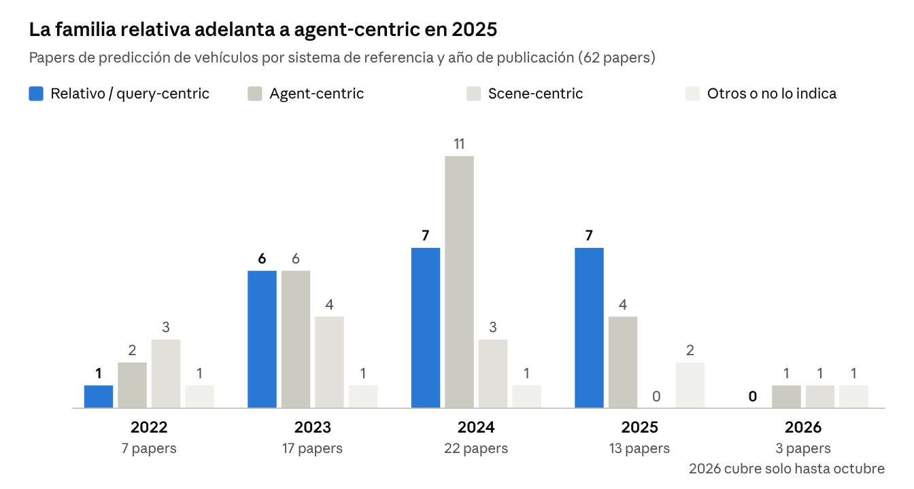
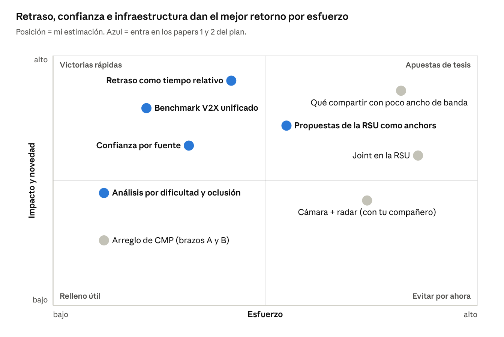
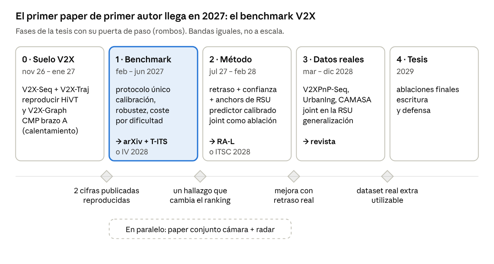

# Informe y plan de ruta: motion prediction V2X

> **Qué es esto.** Copia en Markdown del informe del 5 de noviembre de 2026 (revisado el 9 de noviembre), con las marcas de color y los comentarios de Mario.
> La versión viva y editable es el Claude Doc [«Informe y plan de ruta: motion prediction V2X»](https://claude.ai/artifact/EAPgwYcCpV7zxPiwEtqS7K).
> Resumen para contar el primer paper: [`PAPER1_V2X_BENCHMARK.md`](PAPER1_V2X_BENCHMARK.md).
>
> **Leyenda de marcas de Mario** (el símbolo sustituye al color del texto; el significado es mi lectura, corrígelo si no es así): 🟢 texto verde = importante, de acuerdo · 🟡 texto amarillo = a vigilar · 🔴 texto rojo = riesgo principal · 🔵 texto azul verdoso = contraste · ⭐ = fondo resaltado, prioritario · 💬 = comentario (ver [Comentarios](#comentarios)).
> **Etiquetas de fuente:** [Proyecto] = PDFs y documentos propios · [Repo] = este repositorio · [Web] = papers y páginas consultados el 4–5 nov 2026.
>
> **Cambios del 9 nov 2026:** decidido usar **solo datasets reales** (OPV2V y demás simulados, descartados); la fase 3 valida en datasets reales públicos adicionales.

Mario · 5 nov 2026 (actualizado 9 nov 2026)

## Resumen: lo que te propongo

**Mi recomendación es que tu primer paper de primer autor sea un benchmark V2X unificado, con calibración y robustez a la comunicación, en el primer semestre de 2027.** El segundo sería un predictor relativo que use el retraso y la confianza de cada fuente, con probabilidades calibradas. La colaboración con tu compañero va en paralelo, como paper conjunto. El plan detallado está en la sección 12.

**Las 10 conclusiones, una por cuestión (la lluvia de ideas tiene su propia sección, la 11):**

1.  **Usar predicciones sí merece la pena, pero hay tres formas.** Tus propias predicciones del frame anterior funcionan y son tendencia. Las de los demás agentes sirven para joint. Las que llegan por V2X mejoran poco solas; su valor está en ir acompañadas de confianza y edad del mensaje.

2.  **Agent-centric es el más usado (24 de 62 papers), pero la familia relativa / query-centric le ha alcanzado (21) y en 2025 le adelanta (7 frente a 4).** En V2X-Seq, los 6 papers son relativos. Agent-centric no es el menos preciso: es el más caro. **Corrección:** V2X-RECT (nov 2025) ya llevó QCNet a V2X, en contra de lo que te dije.

3.  **Joint no es raro (22 de 62 papers) y Waymo dejó en 2025 solo el reto joint, no el marginal.** En V2X solo lo hace I2XTraj. Fuera del paper 1, como ablación en el paper 2 y como capítulo "joint en la RSU" en el año 3.

4.  **La dificultad de Kalman sigue siendo la forma estándar de medir el long-tail.** La selección de datos ha ido a otros criterios (TAROT, Den-TP). En V2X sirve para medir dónde ayuda de verdad la infraestructura. Ojo: no tienes ningún dataset V2I real descargado.

5.  🟢 **Los papers de arquitectura no usan UniTraj; lo usan los de datos y evaluación. Y no hay nada parecido para V2X.** Ese hueco es tu paper 1.

6.  **Los sensores crudos son raros (de 2 a 4 papers sobre 62) y caros.** La palanca grande es entrenar con pistas imperfectas (Valeo4Cast: mAPf de 43.3 a 63.0). **Colaboración con GaussianCaR: sí,** como "BEV de cámara + radar → predicción sin mapa HD", en paralelo y con la autoría pactada.

7.  🟢 **Base para entrenar:** encoder relativo, propuesta → refinamiento, reutilizar predicciones pasadas, entrenar con pistas ruidosas y degradación V2X, y probabilidades calibradas. Partir de QCNet no es copiar, pero la aportación tiene que ir encima.

8.  **Jev (TypeSafe AI)** no tiene arquitectura publicada. Su idea útil es la de probabilidades calibradas con un umbral para decidir cuándo actuar. Me equivoqué al tomarlo por JEPA.

9.  🟢 **La calibración ya no es un hueco vacío en single-agent** (Evidential, SPARC, Wu et al. 2026). **En V2X sí lo es:** solo V2INet la toca. El regret, para más adelante.

10. **El benchmark V2X es publicable si trae preguntas:** protocolo único, calibración, robustez, coste y análisis por dificultad. Las cifras actuales no son comparables: el mismo V2X-Graph aparece con 1.05 y con 1.17 de minADE.

🟢 **Lo primero, esta semana:**

- [ ] 🟢 Comprobar cómo descargar V2X-Seq-TFD desde España y bajar V2X-Traj.

- [ ] 🟢 Montar en el bench V2X-Graph y V2INet, y reproducir su cifra en V2X-Seq.

- [ ] 🟢 Escribir a tu compañero proponiendo la opción B y una reunión para pactar interfaz y autoría.

## 1. La innovación de cada paper y si merece la pena usar predicciones

**Sí merece la pena, pero "usar predicciones" son tres cosas distintas y no valen lo mismo.** 🟢 Reutilizar tus propias predicciones del frame anterior es hoy una tendencia fuerte. Usar las predicciones de los demás agentes del mismo instante sirve sobre todo para predicción joint. 🟢 Recibir predicciones por V2X da mejoras pequeñas, salvo que lleguen con su confianza y su retraso; ahí está tu hueco.

Etiquetas de fuente en todo el informe: **\[Proyecto\]** = tus PDFs y documentos; **\[Repo\]** = tu repositorio; **\[Web\]** = papers y páginas consultados entre el 4 y el 5 de noviembre de 2026.

### 1.1 Lo nuevo de verdad en cada paper (mi lectura) \[Proyecto\]

| Paper         | Su innovación, en pocas líneas                                                                                                                                                                                    | Lo que me llevaría a tu modelo                                          |
|---------------|-------------------------------------------------------------------------------------------------------------------------------------------------------------------------------------------------------------------|-------------------------------------------------------------------------|
| UniTraj       | No es un modelo. Unifica 4 datasets en un formato y demuestra que la variedad de datos pesa más que la cantidad. Introduce la evaluación por dificultad de Kalman.                                                | La evaluación por dificultad.                                           |
| QCNet         | Cada elemento vive en su propio marco y las relaciones van en un descriptor relativo, así se reutiliza lo ya calculado entre frames. 🟢 Propone sin anchors y luego refina con anchors.                           | 🟢 El encoder relativo y el esquema propuesta → refinamiento.           |
| MTR           | Queries de intención fijas 🟢 (k-means de destinos) más una 🟢 query dinámica que se mueve al destino predicho. Además predice el futuro denso de todos los vecinos para que el decoder sepa qué harán los demás. | 🟢 Los puntos de intención y la predicción densa de vecinos.            |
| TrajFlow      | Genera todas las trayectorias de una vez con flow matching y entrena las probabilidades de los modos con una pérdida de ranking.                                                                                  | Entrenar la confianza de forma explícita.                               |
| SceneInformer | Predice a la vez lo que ve y si hay alguien en las zonas tapadas.                                                                                                                                                 | 🟢 La oclusión como problema central, que es justo lo que V2X resuelve. |
| CMP           | Primer pipeline que encadena percepción cooperativa, tracking y predicción, y agrega las predicciones de varios coches.                                                                                           | 🟢 El módulo de agregación (tu propuesta de arreglo, brazos A y B).     |
| GameFormer    | Decoder por niveles: en cada nivel, 🟢 cada agente responde a lo que los demás predijeron en el nivel anterior. Predice y planifica a la vez.                                                                     | El razonamiento iterativo de interacción, si haces joint.               |
| Wayformer     | Estudia de forma sistemática cómo 🟢 fusionar las entradas (temprana, tardía, jerárquica) con atención eficiente. Demuestra que 🟢 una arquitectura simple basta.                                                 | Sus conclusiones de fusión, que se aplican a fusionar vistas V2X.       |
| Co-MTP        | 🟢 Fusiona en dos tiempos: 🟢 el pasado visto por coche e infraestructura, y el futuro (predicciones de la infraestructura y plan del AV).                                                                        | 🟢 Usar el futuro de otras fuentes, pero sin información privilegiada.  |
| CoPAD         | Limpia y 🟢 fusiona las pistas de varias fuentes antes del modelo (Hungarian + Kalman), y usa un decoder con anchors.                                                                                             | La fusión temprana barata de pistas.                                    |
| V2X-Graph     | 🟢 Grafo interpretable que asocia las trayectorias de distintas vistas. Publica el dataset V2X-Traj.                                                                                                              | La asociación entre vistas dentro del modelo, y V2X-Traj.               |

### 1.2 Las tres formas de "usar predicciones"

| Forma                                                                  | Ejemplos                                             | Qué dice la evidencia                                                                                                                                                                                                                                                     | ¿Para tu modelo?                               |
|------------------------------------------------------------------------|------------------------------------------------------|---------------------------------------------------------------------------------------------------------------------------------------------------------------------------------------------------------------------------------------------------------------------------|------------------------------------------------|
| 🟢 **Tus propias predicciones del frame anterior** (streaming)         | RealMotion, HPNet, DONUT, SHARP                      | Mejoras pequeñas pero constantes. RealMotion sobre QCNet baja el minFDE₆ en AV2 val de 1.27 a 1.24 \[Repo\]. DONUT pasa de 1.874 a 1.807 de b-minFDE₆ en val y logra 1.79 en test, el mejor sin ensemble \[Web\]. SHARP, el primero de AV2 en 2026, es streaming \[Web\]. | **Sí.** Es la tendencia 2024–2026.             |
| **Predicciones de los demás en el mismo instante**                     | GameFormer (niveles), MTR (futuro denso), BeTop, JAM | Sirven sobre todo para joint. JAM, que primero propone en marginal y luego refina en joint, tiene el mejor minADE/minFDE del test interactivo de WOMD con 17.8 ms \[Web\].                                                                                                | Sí si haces joint; opcional en marginal.       |
| 🟢 **Predicciones que te manda otro coche o la infraestructura** (V2X) | CMP, Co-MTP, I2XTraj, Late Fusion                    | Resultados mixtos (detalle abajo).                                                                                                                                                                                                                                        | **Sí, pero con confianza y retraso adjuntos.** |

Lo que dice la evidencia sobre compartir predicciones por V2X \[Web, salvo que se indique\]:

- **Late Fusion (abr 2026)** 🟢 comparte trayectorias con su varianza y las fusiona con un proceso gaussiano. La mejora es pequeña: en OPV2V el MR baja de 21.97 % a 18.85 %, y en V2V4Real el éxito sube un 1.7 %. Los mensajes caben en 1,500 bytes a 10 Hz.

- **Co-P&P (Wan et al., ago 2026)** compara dónde fusionar. 🟢 Fusionar a nivel de predicción rinde **peor** que fusionar a nivel de detección o de tracking.

- **V2XPnP (ICCV 2025)** llega a lo mismo: 🟢 la fusión intermedia gana a la temprana, y la temprana a la tardía.

- **Co-MTP** sí gana mucho con el futuro (minADE de 0.91 a 0.76) \[Proyecto\]. Pero 🟢 parte de esa mejora viene del plan del AV, que sale del ground truth.

- **I2XTraj (2025)** usa un esquema muy práctico. La infraestructura predice a todos y lo emite en un solo sentido, sin canal de vuelta, y tolera unos 400 ms de retraso.

**Sobre las predicciones "poco sofisticadas".** 🟢 Que la predicción que llega sea simple importa menos que saber cuánto fiarse de ella. Late Fusion usa predictores sencillos (LSTM o Transformer) y aun así mejora, porque cada predicción viaja con su varianza. 🟢 Por eso lo valioso para tu tesis es la confianza explícita que acompaña a la predicción, más que una predicción mejor.

**Mi conclusión.** No es una práctica en desuso: las tres formas siguen vivas en 2026. Para tu modelo: la primera sí desde el principio; la segunda cuando hagas joint; y la tercera es tu terreno de investigación, siempre como "predicción + confianza + edad del mensaje".

## 2. Agent-centric, scene-centric, query-centric y relativo: quién usa qué (2022–2026)

**Agent-centric es el más usado en el total (24 de 62 papers, 39 %), pero la familia relativa / query-centric lo alcanza (21 de 62) y en 2025 lo adelanta (7 frente a 4).** En V2X la situación es más extrema: los 6 papers que trabajan sobre V2X-Seq usan la familia relativa.

*Clasificación propia de 62 papers 2022–2026, leída en cada paper · detalle en la pestaña «Clasificación de los 62 papers»*

**Cómo lo he contado.** Partí del repositorio Awesome-Trajectory-Motion-Prediction-Papers que me pasaste (251 entradas, actualizado en julio de 2026). Me quedé con los papers que proponen un predictor de vehículos y quité peatones, pose humana, ataques, datasets y planificación pura. Le añadí los modelos importantes que faltaban en la lista (MTR++, QCNeXt, ModeSeq, HDGT, GoRela, SIMPL, EDA, MultiPath++…) y todos los papers V2X de predicción que encontré. Salen 62. La clasificación la leí en cada paper, buscando la frase donde dicen en qué marco ponen la escena; 15 vienen de tus PDFs y el resto los abrí en arXiv \[Web\]. Cuento cada paper en el año de su congreso o revista, o en el de arXiv si no tiene. La tabla completa, con la frase que justifica cada caso, está en la pestaña **«Clasificación de los 62 papers»**.

**Las cuatro familias, en una línea cada una:**

- 🟡 **Agent-centric:** se copia la escena entera en el marco de cada agente objetivo. Una copia por objetivo.

- 🔵 **Scene-centric:** un único marco para toda la escena (global, o centrado en el ego o en un agente focal).

- 🟢 **Relativo (estilo HiVT):** cada agente en su marco local y las relaciones entre pares como posición y ángulo relativos.

- 🟢 **Query-centric (QCNet y descendientes):** lo mismo que el relativo, pero añadiendo el tiempo a la relación, lo que permite reutilizar cálculos entre frames. En el gráfico van juntos porque son la misma idea.

### 2.1 🟢 Por qué agent-centric domina si es el peor para n agentes

No es el peor: es **el más caro, pero no el menos preciso**. Hay cuatro razones para su dominio, y un matiz al final:

1.  **Precisión.** "Narrowing the coordinate-frame gap" (2022) lo midió directamente: 🟢 agent-centric es más preciso, y scene-centric es hasta 15 veces más eficiente en escenas densas \[Web\].

2.  **Los benchmarks premian a un solo agente.** AV2 evalúa un agente focal y WOMD hasta 8 objetivos. Repetir la escena por objetivo no penaliza en el leaderboard.

3.  🟢 **Herencia de código.** Muchos modelos de 2024 descienden de MTR (EDA, CMP) o de Forecast-MAE (RealMotion, SHARP; DeMo toma piezas de ambos), que son agent-centric.

4.  🟢 **Sencillez.** No hace falta diseñar codificaciones relativas. SceneMotion defiende además que aprende con menos datos \[Web\].

5.  **El matiz: el coste ya tiene solución sin perder precisión.** GoRela mantiene el tiempo de su encoder casi constante al subir el número de agentes, mientras que repetir por agente cuesta unas 7 veces más con 40 agentes \[Web\]. ADAPT predice a todos en 11 ms frente a 64 ms de HiVT \[Web\].

En el top de AV2 hay empate. DeMo y SHARP son agent-centric; DONUT, ModeSeq y QCNet son query-centric. 🟢 **La precisión no decide el paradigma; lo decide el coste cuando hay muchos agentes, y en V2X hay muchos.**

### 2.2 En V2X

| Paper                    | Datos                         | Paradigma                                      | Base de código           |
|--------------------------|-------------------------------|------------------------------------------------|--------------------------|
| V2X-Graph (NeurIPS 2024) | V2X-Seq, V2X-Traj             | Relativo                                       | 🟢 HiVT                  |
| V2INet (2024)            | V2X-Seq                       | Relativo                                       | HiVT                     |
| Co-MTP (ICRA 2025)       | V2X-Seq                       | Relativo                                       | Grafo heterogéneo propio |
| CoPAD (2025)             | V2X-Seq                       | Relativo                                       | Estilo HiVT              |
| I2XTraj (2025)           | V2X-Seq, SinD                 | Relativo                                       | HPNet                    |
| V2X-RECT (nov 2025)      | V2X-Seq, V2X-Traj             | Query-centric                                  | 🟢 QCNet                 |
| CMP (RA-L 2025)          | OPV2V, V2V4Real               | Agent-centric                                  | 🟢 MTR                   |
| V2XPnP (ICCV 2025)       | V2XPnP-Seq                    | Agent-centric (desacoplado)                    | Propio                   |
| MSMA (2024)              | CARLA                         | Scene-centric (centrado en el coche conectado) | Propio                   |
| Late Fusion (2026)       | OPV2V, V2V4Real, DeepAccident | Marco global                                   | LSTM o Transformer       |
| CAMNet (2025)            | AV2 + mensajes CAM            | Posiciones relativas simples, sin mapa         | VRNN                     |

**Lectura.** Los 6 papers de V2X-Seq usan la familia relativa; ninguno de los 5 de OPV2V, V2V4Real o CARLA la usa. No es una ley de V2X: es herencia. El ecosistema de V2X-Seq viene de HiVT, y el de OPV2V viene del mundo de la percepción (OpenCOOD + MTR). Aun así, el relativo es el que mejor encaja con V2X: cada fuente llega en su propio sistema de coordenadas y con su propio retraso, y el relativo no necesita un marco común para cada objetivo.

**Corrección a mis documentos anteriores.** En el doc de respuestas y en el Word v2 escribí que nadie había llevado el query-centric de QCNet a V2X. **Es falso: V2X-RECT (arXiv, nov 2025) lo hace** \[Web\]. Reporta 0.53 / 0.80 / 0.09 de minADE / minFDE / MR en V2X-Seq, con 104 ms y 1.3 M de parámetros. No he encontrado su código y no he podido comprobar si su protocolo es comparable. Esto cambia tu estrategia (sección 7): ya no basta con "QCNet en V2X"; hay que aportar algo encima. 💬 [C1](#comentarios)

## 3. Joint multi-agent prediction: ¿es lo mejor y hay que dejarla fuera?

**Joint no es "lo mejor" en general: es lo correcto cuando importa que las 🟢 predicciones de varios agentes sean coherentes entre sí (cruces, incorporaciones, planificación). Tampoco es raro: 22 de los 62 papers la ofrecen.** Mi recomendación: 🟢 fuera del primer paper, como extensión medida en el segundo, y con la infraestructura como el sitio natural para hacerla.

### 3.1 Quién la usa

La usan 22 de los 62 papers \[Web + Proyecto\]: Scene Transformer, AutoBots, THOMAS, M2I, FJMP, MotionDiffuser, GameFormer, MotionLM, BiFF, ADAPT, TrafficBots, QCNeXt, MTR++, HPNet, SceneMotion, SMART, BeTop, DriveGPT, JAM, TrajFlow, SHARP e I2XTraj. Tu impresión de que "nadie la usa" viene de que tus 11 papers son 🟢 casi todos marginales; solo GameFormer y TrajFlow reportan joint.

La señal más clara de hacia dónde va el campo: 🟢 **en 2025 Waymo ya no convocó el reto de predicción marginal.** Mantuvo Interaction Prediction (joint), Sim Agents, Scenario Generation y uno nuevo de conducción end-to-end \[Web\].

### 3.2 ¿Es más cara?

Menos de lo que parece. El coste está sobre todo en cómo combinar los modos de varios agentes y en cómo evaluarlos, no en la red:

- **FJMP:** 10 ms por escena sin factorizar, 38 ms con su grafo disperso y 62 ms con el denso, en una V100 \[Web\].

- **JAM:** 17.8 ms con 12.2 M de parámetros \[Web\].

- **ADAPT:** predice a todos los agentes en 11 ms, frente a 64 ms de HiVT \[Web\].

- **Las métricas joint son más duras.** En peatones salen unas 2 veces peores que las marginales ("Joint Metrics Matter", ICCV 2023) \[Web\]. 🟢 Un modelo puede parecer bueno en marginal y producir futuros que chocan entre sí.

### 3.3 En V2X

🟢 **Solo I2XTraj hace joint**: en V2X-Seq obtiene un minJointADE de 0.52 frente a 0.68 de HPNet \[Web\]. 🟢 El protocolo oficial de V2X-Seq es marginal por agente, y por eso nadie más la reporta. Hay un argumento propio de V2X a favor: 🟢 la infraestructura ve a todos los agentes del cruce, así que es el sitio natural para calcular una predicción conjunta y emitirla a los coches.

### 3.4 Decisión que te propongo

1.  **Paper 1 (benchmark):** marginal, que es el protocolo de los datasets. Aun así, reporta una métrica de coherencia barata (tasa de solapamiento entre los modos más probables de cada agente). Enseña si los modelos V2X producen futuros incompatibles.

2.  **Paper 2 (método):** marginal multi-agente en una sola pasada, gracias al encoder relativo. Joint como ablación: un refinamiento joint ligero tipo JAM o GameFormer encima.

3.  **Tesis (año 3):** "joint en la RSU" como capítulo, si los resultados anteriores lo justifican.

## 4. 🟢 La dificultad de Kalman y la elección de datos relevantes

**Sí se sigue usando, aunque no siempre con ese nombre.🟢 **Es la forma estándar de medir el long-tail, la cola de casos difíciles. La selección de datos, en cambio, ya ha pasado a otros criterios. 🟢 Para tu tesis su mejor uso es medir en qué casos ayuda la infraestructura.

### 4.1 De dónde viene y quién la usa

- **Origen.** Makansi et al. (ICCV 2021) definen la dificultad de una muestra como el error de un filtro de Kalman que extrapola su pasado \[Web\]. 🟢 Si un Kalman la acierta, es fácil; si falla mucho, es una maniobra. UniTraj la reutiliza para su evaluación por dificultad \[Proyecto\].

- **Línea long-tail.** FEND (CVPR 2023), AMEND, TrACT y CDKFormer (2025) se evalúan en el subconjunto más difícil \[Web\]. Un trabajo de ITSC 2025 lo resume: los anteriores "ordenaban la dificultad con un filtro de Kalman o con un modelo base" \[Web\]. 🟢 Ese mismo trabajo muestra por qué importa: en el 10 % más difícil de nuScenes, un ensemble baja el error un 13 % respecto a MTR; en el total, mucho menos.

- **Selección de datos.** Ha ido por otro camino, sin Kalman:

  - **TAROT (ICML 2025),** sobre UniTraj, elige el 29.8 % de WOMD + AV2 + nuPlan y entrena mejor que con todo \[Web\]. Wayformer con esos datos logra 0.92 de minADE₅ en nuScenes, frente a 0.94 con todo. 💬 [C2](#comentarios)

  - **Den-TP (CVPR 2026)** agrupa por densidad, es decir, por el número de agentes en la escena. Con el 50 % de AV1, HiVT logra 0.706 / 1.074 de minADE / minFDE, frente a 0.695 / 1.037 con todo y 0.750 / 1.175 con un 50 % al azar \[Web\]. Con HPNet ahorra casi un 45 % del coste de entrenamiento.

### ⭐🟢 4.2 Cómo te sirve en V2X

⭐🟢 Una pregunta barata y publicable dentro del primer paper: **¿la infraestructura ayuda más en los casos difíciles?** Separa V2X-Seq en tramos por dificultad de Kalman y, aparte, en agentes ocluidos o no ocluidos para el coche. Mide la mejora de cooperar en cada tramo. Si la mejora se concentra en el 10 % más difícil, el valor real de V2X queda escondido en la media de minADE, y ese es un hallazgo.

### 4.3 ¿Es WOMD el mejor dataset?

**Para predicción de un solo vehículo sí:** es el más grande, tiene 8 s de horizonte y muchas interacciones \[Proyecto\]. Para una tesis V2X el mapa es otro \[Repo `RECENT_V2X_LITERATURE.md` + Web\]:

| Dataset                     | Tipo                                                         | Qué trae para predicción                              | ¿Lo tienes en `/raid`?                                                                                            |
|-----------------------------|--------------------------------------------------------------|-------------------------------------------------------|-------------------------------------------------------------------------------------------------------------------|
| V2X-Seq (TFD)               | Real, coche + infraestructura                                | 51,146 escenarios de 10 s a 10 Hz, 5 s → 5 s          | **No.** La web dice que se descarga sin límite desde China continental; desde España hay que comprobar el acceso. |
| V2X-Traj                    | Real, 2 coches + infraestructura                             | 10,102 escenarios en 28 cruces, 4 s → 4 s             | No (el repo de V2X-Graph lo enlaza en Google Drive)                                                               |
| V2XPnP-Seq                  | Real, V2V + V2I + I2I                                        | ~100 escenarios en 24 cruces, sensores + trayectorias | No                                                                                                                |
| UrbanIng-V2X (NeurIPS 2025) | Real, 2 coches + hasta 3 postes                              | 3 cruces de Ingolstadt; sobre todo percepción         | No                                                                                                                |
| CAMASA (2026)               | Real, mensajes V2X (CAM)                                     | Trayectorias reconstruidas de 40 M de mensajes        | No                                                                                                                |
| OPV2V                       | Simulado (CARLA), V2V · DESCARTADO: solo usamos datos reales | El que usa CMP                                        | **Sí** (197 GB)                                                                                                   |
| V2V4Real                    | Real, 2 coches                                               | El que usa CMP                                        | **Sí** (41 GB)                                                                                                    |
| V2X-Radar (NeurIPS 2025)    | Real, radar 4D en coche e infraestructura                    | Solo detección, sin trayectorias                      | No                                                                                                                |

**Lo urgente:** tienes 647 GB de WOMD descargados (y tres repos preprocesados sobre él), pero ningún dataset V2I real. El primer paso práctico del nuevo plan es conseguir V2X-Seq-TFD y V2X-Traj.

**Decisión (9 nov 2026): solo datasets reales.** OPV2V y cualquier dataset simulado (CARLA, el sintético de Pretraining-on-Synthetic) quedan descartados y se pueden borrar del ordenador. V2V4Real se queda: es real.

## 5. ¿Usan UniTraj los papers recientes?

**Los papers de arquitectura no lo usan; lo usan los de datos, generalización y evaluación. Y no soporta V2X.**

### 5.1 Evidencia

- **Ninguno de los modelos punteros de 2024–2026 de mi tabla se entrena en UniTraj** \[Web\]. DeMo, RealMotion, SMART, ModeSeq, DONUT y SHARP se entrenan con el código de su predecesor y el devkit oficial de cada dataset.

- **Según Semantic Scholar, 78 papers citan UniTraj** \[Web\]. Los que de verdad lo usan como plataforma son de otro tipo:

  - TAROT (ICML 2025), para seleccionar datos.

  - "Closing the Loop" (2025), que conecta Autobot, Wayformer y MTR a un planificador en bucle cerrado.

  - Varios trabajos de generalización entre datasets.

- **Muchos solo lo citan.** ControlledShifts (2026), que estudia robustez en WOMD, cita UniTraj solo por sus métricas y no se construye sobre él \[Web\].

- **El repo sigue vivo pero crece en otra dirección** \[Web\]: TAROT en diciembre de 2024, SMART en mayo de 2025, Forecast-MAE y EMP en septiembre de 2025. Tiene 490 estrellas, sigue con WOMD, nuPlan, nuScenes y AV2, y no tiene nada de V2X.

### 5.2 Por qué no lo usan

1.  **Los leaderboards exigen el protocolo oficial.** El config por defecto de UniTraj usa 2.1 s de pasado y 6 s de futuro para todos los datasets, que no es el de WOMD ni el de AV2 \[Proyecto\].

2.  **Es agent-centric por diseño.** Hace una copia de la escena por agente objetivo. Los modelos relativos o query-centric no encajan sin reescribir su carga de datos.

3.  **Cada modelo nuevo nace del código de su padre.** QCNet da lugar a DONUT y ModeSeq; Forecast-MAE da lugar a RealMotion y SHARP.

4.  **ScenarioNet unifica a costa de perder detalle propio de cada dataset.** Por defecto enmascara la altura y el tamaño de los agentes \[Proyecto\].

5.  **Licencia AGPLv3** \[Repo `REPO_ASSESSMENT.md`\]. Obliga a publicar como código abierto todo lo que se construya encima.

### ⭐🟢 5.3 Qué significa para ti

⭐🟢 UniTraj sirve para experimentos de generalización entre datasets de un solo vehículo. **Para V2X no existe su equivalente, y construirlo es precisamente el paper de benchmark de la sección 10.** Ese hueco es una oportunidad: "el UniTraj de V2X" con protocolo único, robustez y calibración.

## 6. Sensores crudos (LiDAR, cámara) y la colaboración con tu compañero

**Muy pocos usan sensores crudos: 2 de los 62 papers del recuento (CMP y V2XPnP), o 4 de 64 (6 %) si sumo MoST y MGTR, que están en la lista Awesome. Añadirlos mejora algo (en torno a un 6 % en mAP en WOMD), pero es muy caro, y un pipeline modular bien entrenado sigue ganando.** La colaboración con tu compañero tiene sentido si se plantea como "BEV de cámara + radar → predicción" y no como un paper de percepción.

### 6.1 Qué consiguen los que usan sensores \[Web, salvo que se indique\]

| Trabajo                 | Sensores                                       | Qué hace                                                   | Resultado clave                                                                          | Coste                                     |
|-------------------------|------------------------------------------------|------------------------------------------------------------|------------------------------------------------------------------------------------------|-------------------------------------------|
| MoST (CVPR 2024)        | Cámara + LiDAR                                 | Añade unos cientos de tokens de sensor a Wayformer en WOMD | mAP 0.3995 → 0.4230 (+5.9 %), minFDE 1.231 → 1.136 (−7.8 %); cámara sola ya da casi todo | 64 núcleos TPUv4, 500k pasos              |
| MGTR (ICRA 2024)        | Rasgos de LiDAR + vectores                     | Fue 1.º en el leaderboard de WOMD en su momento            | No publica la mejora atribuible al LiDAR                                                 | —                                         |
| WOMD-LiDAR (2023–24)    | LiDAR                                          | Añade LiDAR a más de 100k escenas de WOMD                  | Dice que mejora, sin cifras en el resumen                                                | —                                         |
| Valeo4Cast (ECCVW 2024) | Cámaras → detección → tracking → MTR (modular) | Gana el reto end-to-end de AV2 con 63.82 mAPf              | **Ajustar MTR con detecciones reales sube el mAPf de 43.3 a 63.0**                       | Modular, cada pieza por separado          |
| UniAD (CVPR 2023)       | Cámaras                                        | Pila completa                                              | —                                                                                        | 30–50 GB por GPU solo la etapa 1 \[Repo\] |
| SpaRC-AD (ICCVW 2025)   | Cámara + radar                                 | End-to-end con velocidad Doppler                           | −4 % de error de movimiento frente a solo visión                                         | —                                         |
| CMP (RA-L 2025)         | LiDAR cooperativo                              | Percepción cooperativa + tracking + MTR                    | Ver tus fichas \[Proyecto\]                                                              | Pesado                                    |
| V2XPnP (ICCV 2025)      | LiDAR cooperativo                              | Percepción y predicción juntas                             | ADE 1.35 frente a 1.87 sin cooperar                                                      | Mensaje comprimido 32×                    |
| UniV2X (AAAI 2025)      | Cámaras coche + infraestructura                | End-to-end orientado a planificar                          | Colisiones 0.89 % → 0.34 %                                                               | 8.1·10⁵ bps frente a 8.2·10⁷              |
| Co-P&P (ago 2026)       | LiDAR comprimido                               | Compara dónde fusionar                                     | Fusionar predicciones es lo peor; un códec neuronal reduce el ancho de banda 34×         | —                                         |

**Lectura.** Los sensores dan información que las pistas pierden: forma, señales e intención visual. Pero la palanca más grande que he visto es **entrenar el predictor con pistas imperfectas**: el salto de 43.3 a 63.0 de Valeo4Cast. Para una tesis sin percepción, la conclusión práctica es simular errores de tracking (IDs cambiados, huecos, ruido) o usar salidas reales de un detector. No hace falta procesar sensores.

### 6.2 El paper de tu compañero: GaussianCaR (arXiv 2602.08784)

**Qué es** \[Web\]:

- **Autores:** Montiel-Marín, Antunes-García, Sánchez-García, Llamazares, Holger Caesar y Bergasa (Universidad de Alcalá y TU Delft), febrero de 2026.

- **Qué hace:** proyecta cámaras y radar a una vista de pájaro (BEV) común mediante Gaussian Splatting. Saca la segmentación de vehículos (57.3 IoU), carretera (82.9) y líneas de carril (50.1) en nuScenes.

- **Velocidad:** 3.2 veces más rápido que BEVCar, con 75.6 ms en una RTX 4090. Se entrenó en 4 A100.

- **Límite:** solo segmenta el instante actual. No hace tracking ni predice el futuro, y no menciona V2X.

**Mi opinión: sí tiene sentido, con condiciones.**

A favor:

- **Sois complementarios:** ellos aportan la percepción y tú la predicción.

- **Holger Caesar es coautor.** Creó nuScenes, y eso da peso al paper.

- **El radar mide velocidad directamente** (Doppler), que es justo lo que un predictor necesita.

- **El radar es habitual en las unidades de infraestructura**, así que es un puente natural a V2X.

- **Las gaussianas encajan bien en V2X.** Son primitivas 3D que se pasan de un marco a otro con una rotación y una traslación, sin remuestrear una rejilla. Un trabajo de AAAI 2026 comparte gaussianas entre agentes para ocupación con el 34.6 % del volumen de comunicación \[Web\].

En contra:

- No es V2X.

- Un primer paper así tira hacia percepción.

- Ellos entrenan en 4 A100 y tú tienes una 3090.

- El hueco end-to-end está concurrido: UniAD, SparseDrive y ya hay radar + cámara con predicción (SpaRC-AD).

| Opción                                                                      | Qué sería                                                                                                                                                                                                                                        | Encaje con tu tesis                                                  | Riesgo                                         |
|-----------------------------------------------------------------------------|--------------------------------------------------------------------------------------------------------------------------------------------------------------------------------------------------------------------------------------------------|----------------------------------------------------------------------|------------------------------------------------|
| A. Ocupación futura en BEV                                                  | Añadir tiempo y una cabeza de futuro a GaussianCaR (estilo FIERY)                                                                                                                                                                                | Bajo: es su paper con tu ayuda                                       | Bajo                                           |
| **B. BEV de cámara + radar como mapa y contexto de un predictor vectorial** | Tu predictor atiende directamente a sus rasgos BEV en vez de a un mapa HD. Precedente: con solo cámara, atender al BEV en vez de al mapa vectorizado da hasta un 29 % más de precisión y un 73 % más de velocidad (Gu et al., ECCV 2024) \[Web\] | **Medio:** predicción sin mapa HD, que en V2X también falta a menudo | Medio                                          |
| C. Gaussianas de cámara + radar compartidas por V2X → predicción            | La infraestructura envía gaussianas; el coche predice                                                                                                                                                                                            | Alto                                                                 | Alto: V2X-Radar no tiene trayectorias anotadas |

**Mi recomendación: la opción B como paper conjunto en 2027, diseñada para crecer hacia la C en tu tesis.** No la haría tu primer paper de primer autor; ese debería ser V2X. Cómo lo haría: 💬 [C3](#comentarios)

1.  **Acordad la interfaz.** Ellos exportan los rasgos BEV o las gaussianas por frame en nuScenes; tú construyes el predictor que los consume.

2.  **Pactad la autoría por escrito antes de empezar.**

3.  **Baselines:**

    - predictor con mapa HD (cota superior);

    - mapa online (MapTR) + predictor;

    - BEV de solo cámara (Gu et al.);

    - el vuestro, con radar.

4.  **Métricas:** minADE, minFDE, MR y latencia.

5.  **Destino:** ITSC 2027 o ICRA 2028.

6.  **Pregunta clave del paper:** ⭐🟢 ¿cuánto aporta el radar a la predicción cuando no hay mapa HD?

## 7. Qué tener en cuenta cuando entrenemos

🟢 **Sí: un encoder relativo / query-centric, un decoder que propone y luego refina con anchors, y reutilizar predicciones pasadas es la base que mejor encaja con V2X. Partir de QCNet no es copiar.** Pero como V2X-RECT ya llevó QCNet a V2X, tu aportación tiene que estar en lo que añades encima: retraso, confianza y calibración.

### 7.1 Sobre "copiarte de QCNet"

Construir sobre un backbone publicado es la norma, no la excepción \[Web\]:

- ModeSeq (CVPR 2025) y DONUT (ICCV 2025) usan el encoder de QCNet.

- V2X-RECT (2025) y Recover to Predict (CVPR 2026) parten de QCNet.

- SmartRefine (CVPR 2024) se monta encima de cinco backbones distintos.

Lo que se publica es la pregunta que respondes y el módulo que la responde, con QCNet citado como base. Tiene además licencia Apache-2.0 \[Repo\].

### ⭐🟢 7.2 Lista de decisiones para el entrenamiento

| \#  | Decisión                            | Mi recomendación                                                                                                                                                                                              | Evidencia                                                                                                                                                                                                                                                 | Prioridad              |
|-----|-------------------------------------|---------------------------------------------------------------------------------------------------------------------------------------------------------------------------------------------------------------|-----------------------------------------------------------------------------------------------------------------------------------------------------------------------------------------------------------------------------------------------------------|------------------------|
| 1   | Sistema de referencia               | Relativo / query-centric, todos los agentes en una sola pasada                                                                                                                                                | GoRela, SIMPL y ADAPT: el coste no crece con los agentes; encaja con varias fuentes (sección 2) \[Web\]                                                                                                                                                   | Alta                   |
| 2   | **Tiempo real de cada observación** | Que cada dato V2X entre con el instante en que se midió, no con el del frame actual. Así el retraso de un mensaje es solo otra posición temporal en el descriptor relativo, sin módulo de compensación aparte | ⭐🟢 QCNet ya codifica el tiempo relativo \[Proyecto\]. No he visto ningún paper V2X que lo use así, pero no es una búsqueda exhaustiva                                                                                                                  | **Alta (idea propia)** |
| 3   | Decoder                             | Propuesta sin anchors → refinamiento con anchors; o puntos de intención por k-means                                                                                                                           | QCNet: b-minFDE₆ 2.10 → 2.02 con recurrencia → 1.90 con refinamiento. MTR: k-means 0.3437 de mAP frente a rejilla 0.3178. CoPAD: 2 anchors por modo es lo mejor \[Proyecto\]                                                                              | Alta                   |
| 4   | Pérdida de modos                    | Winner-take-all + clasificación como base; probar la versión con recocido (aWTA). Entrenar con los K modos que vas a evaluar (6)                                                                              | aWTA en MTR, AV2 val: minFDE 1.68 → 1.46 y MR 0.30 → 0.19, y un 20 % menos de tiempo de entrenamiento \[Web\]                                                                                                                                             | Media                  |
| 5   | **Probabilidades fiables**          | Fine-tuning EM de un paso o una pérdida de ranking para que la probabilidad de cada modo signifique algo                                                                                                      | Wu et al. (2026): winner-take-all se comporta como k-means y trocea cada comportamiento en varios modos con probabilidad baja; el fine-tuning EM baja el NLL de Wayformer un 59 % en nuScenes \[Web\]. TrajFlow mejora el mAP con su ranking \[Proyecto\] | **Alta para tu tesis** |
| 6   | Distribución de salida              | Laplace por defecto (HiVT, QCNet, V2X-Graph, CoPAD); Gauss si quieres NLL comparable con MTR                                                                                                                  | No he encontrado una comparación limpia que dé un ganador claro; Laplace es más robusta a errores grandes                                                                                                                                                 | Baja                   |
| 7   | Predicciones pasadas (streaming)    | Reutilizar las del frame anterior                                                                                                                                                                             | RealMotion, DONUT, SHARP (sección 1)                                                                                                                                                                                                                      | Media (paper 2)        |
| 8   | **Entrenar con pistas imperfectas** | Meter IDs cambiados, huecos y ruido en el entrenamiento, o usar pistas de un tracker real                                                                                                                     | Valeo4Cast: mAPf 43.3 → 63.0 al ajustar con detecciones. V2X-RECT dedica un módulo a corregir IDs \[Web\]                                                                                                                                                 | Alta                   |
| 9   | Aumentación de degradación V2X      | Retrasos de 0 a 1.5 s, pérdidas del 10–50 % y ruido de posición durante el entrenamiento                                                                                                                      | MSMA retrasa de 1 a 15 frames; V2X-Graph prueba 0–200 ms y 10–50 % de pérdidas \[Web + Proyecto\]                                                                                                                                                         | Alta                   |
| 10  | Datos                               | Preentrenar en AV2 o WOMD (ya los tienes) y ajustar en V2X                                                                                                                                                    | Un estudio de Bosch (2025): preentrenar en AV2 y ajustar en su dataset alemán mantiene el resultado en casa (0.70 frente a 0.69) y mejora mucho en AV2 (0.82 frente a 0.99) \[Web\]                                                                       | Media                  |
| 11  | Tamaño                              | Modelos de 1 a 5 M de parámetros, que caben de sobra en tu 3090                                                                                                                                               | HiVT 2.6 M, SIMPL 1.8 M y V2X-RECT 1.3 M, frente a MTR 65 M \[Web + Repo\]                                                                                                                                                                                | Alta                   |
| 12  | Métricas desde el día 1             | minADE, minFDE y MR + brier-minFDE + NLL o ECE + latencia, por tramo de dificultad                                                                                                                            | Secciones 4 y 9                                                                                                                                                                                                                                           | Alta                   |

### 7.3 Lo que no haría todavía

- **Modelos generativos (difusión o flow matching) o autoregresivos por tokens (MotionLM, SMART).** Son la frontera en simulación, pero cuestan más y no son tu pregunta.

- **Ensembles para subir en el leaderboard.** No responden a ninguna pregunta de la tesis.

## 8. Jev, de TypeSafe AI

**Corrección primero:** en el doc de respuestas interpreté "jev" como JEPA y me equivoqué. Jev salió en septiembre de 2026, después de la fecha hasta la que llega mi conocimiento, y no lo conocía. **Conclusión: no hay arquitectura que copiar (no es pública), pero sí una idea que encaja con tu tesis: probabilidades calibradas y un umbral que decide cuándo actuar y cuándo no fiarse.**

### 8.1 Qué es \[Web\]

- **Qué se le pide.** Es un modelo "System One" (la idea de pensamiento rápido de Kahneman) para decisiones rápidas dentro de software. Recibe una pregunta estructurada con las opciones permitidas. Devuelve una decisión tipada con su probabilidad y su confianza.

- **Cómo genera.** Produce todos los campos de la respuesta en una sola pasada, no token a token como un LLM.

- **Cómo se entrena.** Con "Reinforcement Learning for Calibrated Decisions" (RLCD): buscan que la probabilidad que da coincida con lo a menudo que acierta.

- **Cifras de la propia empresa.** 0.114 s frente a 8.566 s de un LLM, y "193.6× más rápido, 444.6× más barato". Cuesta 42 \$ por cada mil millones de tokens de entrada. El desarrollador fija un umbral: por encima, Jev actúa solo; por debajo, lo pasa a una persona.

- **Quién está detrás.** Lo fundó Diogo Almeida, ex-OpenAI, con una ronda de 40 M\$. El 6 de octubre de 2026 OpenAI sacó su "Decisions API" como respuesta.

- **Lo que no se sabe.** No hay paper ni pesos, y la arquitectura no está publicada. Ninguna medida de calibración (ECE, Brier) está verificada de forma independiente. Las demos de conducción son en simulador.

### 8.2 Qué te puedes llevar

1.  **La confianza como producto.** El valor de un predictor no está solo en acertar con la mejor de 6 trayectorias. También está en que su probabilidad sea creíble. En V2X eso decide cuándo fiarse de lo que manda la infraestructura y cuándo de lo propio. Es tu sección 9.

2.  **Entrenar para la calibración, no solo para la precisión.** El equivalente a RLCD en predicción son las pérdidas que premian probabilidades honestas: NLL, Brier, el ranking de TrajFlow o el fine-tuning EM de Wu et al. (sección 7, fila 5).

3.  **Decidir cuándo no actuar.** Si la confianza baja de un umbral, se cae a un plan conservador o se pide ayuda a la infraestructura. En predicción se llama predicción selectiva o conformal, y V2INet ya lo hace en V2X-Seq \[Web\].

4.  **Salida de una sola pasada.** Ya es la norma en MTR y QCNet, que sacan los K modos a la vez. Los modelos por tokens como MotionLM o SMART van en dirección contraria y son más lentos. Para tiempo real en V2X, una sola pasada es lo correcto.

**Veredicto:** úsalo como inspiración para contar el capítulo de calibración ("predictores que saben cuándo no saben"). Técnicamente no hay nada que reutilizar.

## 9. Segunda vuelta a la calibración y al regret: ¿sigue siendo tuyo ese hueco?

**Hay que matizar lo que te dije.** "Nadie mide la calibración" ya no es cierto en predicción de un solo vehículo: en 2025–2026 han salido varios trabajos. **Lo que sigue libre es la calibración en V2X**: si cooperar mejora o empeora la fiabilidad de las probabilidades, cómo se degrada con el retraso, y cómo usar esa confianza para fusionar fuentes. El regret lo dejaría para más adelante.

### 9.1 Qué existe ya \[Web\]

| Trabajo                 | Qué aporta                                                                                                         | Dato clave                                                                                                  |
|-------------------------|--------------------------------------------------------------------------------------------------------------------|-------------------------------------------------------------------------------------------------------------|
| Evidential (2025)       | Incertidumbre de posición y de modo en una sola pasada                                                             | ECE en AV2: 0.05 con HiVT, 0.01 con su cabeza evidencial                                                    |
| Wu et al. (2026)        | Explican por qué las probabilidades de los modos salen poco informativas: winner-take-all se comporta como k-means | Fine-tuning EM: NLL de Wayformer −59 % en nuScenes                                                          |
| SPARC (ago 2026)        | Capa bayesiana + conformal que da tubos de confianza del 95 % sin muestrear                                        | Primero en NLL en sus pruebas                                                                               |
| Regret (CoRL 2024)      | Mide el error según el daño que causa al planificador                                                              | Necesita un planificador                                                                                    |
| Closing the Loop (2025) | Lleva los predictores a bucle cerrado con un planificador                                                          | MTR-Mini (9.3 M) supera a MTR (65 M) en bucle cerrado: 0.850 frente a 0.818, aunque es 5.º en bucle abierto |
| ControlledShifts (2026) | Robustez bajo cambios de distribución en WOMD                                                                      | Los rankings de calidad y de estabilidad salen casi al revés; no mide calibración                           |

### 9.2 Qué hay en V2X

- **V2INet** envuelve el predictor con predicción conformal en V2X-Seq. Sin calibrar cubre el 78 % frente al 90 % objetivo \[Repo `MODELS_OVERVIEW.md`\].

- **Late Fusion (2026)** comparte la varianza de cada predicción y la usa para fusionar \[Web\].

- **Nadie más.** Co-MTP, CoPAD, V2X-Graph, V2X-RECT e I2XTraj solo reportan minADE, minFDE y MR \[Proyecto + Web\].

### 9.3 El hueco, reformulado

⭐🟢 Tres preguntas que, hasta donde he podido buscar, nadie ha respondido:

1.  ⭐🟢 **¿Están calibrados los predictores V2X?** Y si se mide brier-minFDE o NLL, ¿cambia el ranking que da minADE?

2.  ⭐🟢 **¿La infraestructura mejora la calibración además de la precisión?** ¿En qué casos: los difíciles, los ocluidos?

3.  ⭐🟢 **Con retraso y pérdidas de mensajes, ¿se degrada antes la calibración que el minADE?** Si es así, el modelo se vuelve "seguro de sí mismo y equivocado" justo cuando la comunicación falla, que es lo peligroso.

⭐🟢 Y una cuarta, de método: **usar la confianza calibrada como peso de fusión.** Eso conecta con el brazo B de tu propuesta para CMP y responde a la crítica de Late Fusion.

### 9.4 ¿Y el regret?

Necesita un planificador, y V2X-Seq no lo trae. Ponerlo a mano (por ejemplo, un planificador simple sobre las predicciones, al estilo de "Closing the Loop") es un proyecto en sí. Lo dejaría para el año 3 o para un paper de bucle cerrado. Las tres preguntas de arriba se pueden responder ya con las métricas de bucle abierto.

## 10. ¿Es publicable re-entrenar todo V2X como benchmark?

**Sí, si es un benchmark con preguntas y no una tabla re-entrenada.** Necesita un protocolo único, robustez, calibración, coste y código abierto. **Es el primer paper de primer autor que te recomiendo:** el riesgo es bajo, cabe en tu GPU y deja la base de todo lo demás.

### 10.1 Por qué hace falta

El mismo modelo aparece con cifras distintas según quién lo cuente \[Proyecto + Web\]:

- **V2X-Graph** da 1.05 / 1.79 / 0.25 en su paper de NeurIPS. Co-MTP, CoPAD y V2X-RECT le atribuyen 1.17 / 2.03 / 0.29.

- **HiVT** aparece entre 1.12 y 1.29 de minADE en el mismo dataset.

- **Co-MTP** usa otro protocolo (3 s → 5 s a 5 Hz) y el futuro real del AV como "plan".

- **V2X-RECT** dice 0.53 / 0.80 / 0.09, casi la mitad que todos los demás, y sin código para comprobarlo.

Hoy nadie puede decir qué método V2X es mejor.

### 10.2 Precedentes de que este tipo de paper se publica \[Web + Proyecto\]

- **UniTraj (ECCV 2024)** y **"What Truly Matters in Trajectory Prediction" (NeurIPS 2023)** son análisis y frameworks, no modelos.

- **STEP (IEEE Open Journal of ITS, 2025)** y **"Toward Unified Practices…" (IV 2025)** son plataformas y prácticas de benchmarking (estos dos los conozco solo por el título, en la lista de citas de UniTraj).

- **V2XPnP (ICCV 2025)** comparó 11 modelos de fusión en su propio dataset. Ojo, que se solapa en parte contigo: es end-to-end desde LiDAR y en su dataset. **Tu diferencia:** predicción a nivel de trayectorias, en V2X-Seq y V2X-Traj, con robustez y calibración.

### ⭐🟢 10.3 Qué tendría que tener para no ser "solo un re-run"

| Pieza              | Contenido                                                                                                                                                                                                                                                                    |
|--------------------|------------------------------------------------------------------------------------------------------------------------------------------------------------------------------------------------------------------------------------------------------------------------------|
| Datasets           | V2X-Seq-TFD y V2X-Traj; V2V4Real como extra para V2V (real, ya lo tienes). OPV2V descartado por ser simulado                                                                                                                                                                 |
| Métodos con código | HiVT (base), V2X-Graph (código y checkpoint), V2INet (código), Co-MTP (código en GitHub, último commit en marzo de 2025), la predicción de CMP y un QCNet adaptado por ti. CoPAD, V2X-RECT e I2XTraj sin código encontrado: se citan, se marca y se explica por qué no están |
| Un protocolo       | Mismo split, horizonte, frecuencia y entradas. Sin información privilegiada (nada de futuro real del AV). Varias semillas                                                                                                                                                    |
| Ejes de análisis   | Precisión; calibración (brier-minFDE, NLL); robustez (retraso 0–500 ms, pérdidas 10–50 %, ruido); coste (ms, parámetros, bytes por mensaje); por tramos de dificultad de Kalman y de oclusión                                                                                |
| Entregable         | Configs, Docker (tu bench) y una tabla de referencia que otros puedan reutilizar                                                                                                                                                                                             |

### 10.4 Riesgos

- 🔴 **Acceso a V2X-Seq.** La web dice que se descarga sin límite desde China continental; desde España puede requerir solicitud. Es lo primero que hay que comprobar.

- 🟢 **Cómputo.** Mi estimación gruesa: 5 o 6 métodos × 2 datasets × 3 semillas son unos 30–40 entrenamientos. Con modelos de 1–5 M de parámetros en unos 50k escenarios, eso es del orden de 1 a 2 meses de una sola 3090. Es viable, pero hay que empezar pronto.

- 🟡 **Revisores que lo vean como "solo reproducir".** Se mitiga con las preguntas de la sección 9.3 y del análisis por dificultad (4.2): que el paper diga algo nuevo, por ejemplo que el ranking cambia al medir calibración o retraso.

- 🔴 **Que alguien lo publique antes.** No he encontrado un benchmark unificado de predicción V2X a nivel de trayectorias, pero el campo se mueve rápido. Conviene sacar una versión en arXiv pronto.

**Destino:** IEEE T-ITS o RA-L como revista (sin fecha límite), o IV 2028 como conferencia. ITSC 2027 sería muy apretado. NeurIPS Datasets & Benchmarks solo si llega muy completo.

## 11. Lluvia de ideas inicial

**Tienes razón en que habrá que innovar, pero no hace falta inventar una arquitectura entera.** Las ideas con más retorno salen de tres cosas que V2X tiene y la predicción de un solo coche no: el retraso de los mensajes, la fiabilidad de cada fuente y una infraestructura que lo ve todo. Aquí van las 9 que yo pondría sobre la mesa para la primera sesión.

*Lluvia de ideas inicial · 9 ideas situadas por esfuerzo e impacto (mi estimación)*

| Idea                                      | Qué es                                                                                                                                                                                            | Por qué es nueva                                                                                                           | Riesgo principal                                                 |
|-------------------------------------------|---------------------------------------------------------------------------------------------------------------------------------------------------------------------------------------------------|----------------------------------------------------------------------------------------------------------------------------|------------------------------------------------------------------|
| **Retraso como tiempo relativo**          | 🟢 Encoder query-centric donde cada observación V2X entra con su instante real. Un mensaje con 300 ms de retraso es simplemente un dato 300 ms más viejo, y la red aprende a usarlo.              | Los papers V2X compensan el retraso con módulos aparte (interpolación en V2X-Graph, extrapolación en UniV2X) o lo ignoran. | 🟡 Que la mejora sobre una simple interpolación sea pequeña.     |
| **Confianza por fuente**                  | Un "token de fiabilidad" por fuente (edad del mensaje, score de detección, covarianza del tracker) que entra en la atención. Generaliza el brazo B de tu propuesta para CMP.                      | Tu búsqueda de septiembre no encontró a nadie haciéndolo en la entrada del predictor \[Repo\].                             | Definir bien qué es "confianza" (lo apunta tu propia propuesta). |
| **Propuestas de la RSU como anchors**     | 🟢 La infraestructura emite K trayectorias calibradas en un solo sentido, con pocos bytes. El coche las usa como anchors en su etapa de refinamiento, igual que QCNet usa sus propias propuestas. | Une el esquema de I2XTraj (emitir) con el de QCNet (refinar); no lo he visto junto.                                        | 🟡 Depende de que las propuestas de la RSU sean buenas.          |
| 🟢 **Benchmark V2X unificado** 💬[C4](#comentarios)            | Sección 10.                                                                                                                                                                                       | No existe para predicción a nivel de trayectorias.                                                                         | Acceso a datos y cómputo.                                        |
| 🟢 **Análisis por dificultad y oclusión** 💬[C4](#comentarios) | Sección 4.2: dónde ayuda de verdad la cooperación.                                                                                                                                                | Nadie lo ha medido en V2X.                                                                                                 | Ninguno serio; va dentro del paper 1.                            |
| **Qué compartir con poco ancho de banda** | Elegir qué agentes y qué modos enviar según cuánto mejoran la predicción del receptor, el equivalente de Where2comm para predicción.                                                              | La literatura de presupuesto de comunicación es casi toda de percepción.                                                   | Necesita simular la red; es más grande.                          |
| **Joint en la RSU**                       | La infraestructura calcula futuros conjuntos coherentes y los emite.                                                                                                                              | Solo I2XTraj hace joint en V2X.                                                                                            | Grande; mejor como capítulo del año 3.                           |
| **Cámara + radar (con tu compañero)**     | Sección 6.2, opción B y luego C.                                                                                                                                                                  | Radar + gaussianas para predicción sin mapa.                                                                               | 🟡 Deriva hacia percepción.                                      |
| **Arreglo de CMP (brazos A y B)**         | Tu propuesta actual \[Repo `FIRST_EXPERIMENT_PROPOSAL.md`\].                                                                                                                                      | El brazo A es un arreglo de código; el B es la parte nueva.                                                                | El brazo A solo no da para paper.                                |

**Cómo encajan.** El benchmark (paper 1) incluye el análisis por dificultad. El método (paper 2) junta las tres ideas azules de arriba (retraso, confianza y propuestas de la RSU) en un solo predictor calibrado. Esa combinación ya es una contribución con identidad propia, y no "QCNet en V2X". El arreglo de CMP queda como experimento de calentamiento de una o dos semanas, no como paper.

## 12. Plan de ruta nuevo, centrado 100 % en V2X

**El cambio principal respecto a tu `PHD_ROADMAP.md`: el primer paper deja de ser single-agent (calibración en AV2 o generalización de mapas) y pasa a ser V2X desde el principio, con el benchmark unificado.** Las dos ideas que tenías para el año 1, calibración y robustez, no se pierden: entran como ejes de ese benchmark, aplicados a V2X.

*Plan de ruta propuesto · 5 fases, 4 puertas de paso, 1 línea paralela*

### 12.1 Fase 0 · Suelo V2X (noviembre 2026 – enero 2027)

- [ ] Pedir y descargar **V2X-Seq-TFD**. Comprobar el acceso desde España primero (sección 10.4).

- [ ] Descargar **V2X-Traj** (Google Drive, desde el repo de V2X-Graph).

- [ ] Añadir al bench Docker **V2X-Graph** (código + checkpoint), **Co-MTP** (código) y **V2I_trajectory_prediction** (V2INet). Este último ya está en `setup.sh --all`, solo falta el Docker \[Repo\].

- [ ] Reproducir dos cifras publicadas en V2X-Seq: HiVT y V2X-Graph con su checkpoint. **Puerta: ambas dentro de un ±5 % de lo publicado.**

- [ ] Validar el checkpoint de CMP solo en V2V4Real (Track A de `TRAINING_PLAN.md`) y hacer el brazo A del arreglo como calentamiento de 1 o 2 semanas.

- [ ] **Aparcar** lo que no está en el camino V2X. Que termine lo que ya corre (SceneInformer, GameFormer); no lanzar los entrenamientos completos de MTR ni de TrajFlow en WOMD; dejar UniAD.

### 12.2 Fase 1 · Paper 1, benchmark V2X (febrero – junio 2027)

- Protocolo único en V2X-Seq y V2X-Traj, con 5 o 6 métodos re-entrenados y varias semillas (sección 10.3).

- Ejes: precisión, calibración (brier, NLL), robustez a retraso y pérdidas, coste, y tramos de dificultad y oclusión (sección 4.2).

- **Puerta: al menos un hallazgo que cambie el ranking** (por ejemplo, que el mejor en minADE no sea el mejor calibrado o el más robusto). Sin eso, el paper es solo una tabla.

- Envío: arXiv en cuanto esté (verano de 2027) y luego IEEE T-ITS o RA-L, que no tienen fecha límite. Como conferencia, IV 2028, que suele cerrar entre enero y febrero. Las fechas límite son aproximadas; hay que comprobarlas cada año.

### 12.3 Fase 2 · Paper 2, el método (julio 2027 – febrero 2028)

- Predictor relativo / query-centric con: retraso como tiempo relativo, token de confianza por fuente, propuestas de la RSU como anchors y probabilidades calibradas (secciones 7 y 11).

- Ablaciones: cada pieza por separado, comparado con V2X-RECT si su código aparece; joint ligero como ablación.

- **Puerta: mejora en precisión y en calibración bajo retraso realista, medida en tu propio benchmark.**

- Envío: RA-L (sin fecha límite, con opción de presentarlo en ICRA o IROS) o ITSC 2028, que suele cerrar en marzo o abril.

### 12.4 En paralelo · Paper conjunto con tu compañero (2027)

Opción B de la sección 6.2. Que su ritmo no frene el tuyo: si se retrasa, se mueve; los papers 1 y 2 no.

### 12.5 Fase 3 · Datos reales y joint (2028)

- Validación en UrbanIng-V2X y CAMASA (mensajes reales con pérdidas y retrasos reales).

- Capítulo de joint en la RSU.

- **Puerta: un dataset real adicional utilizable para validar fuera de V2X-Seq.** Candidatos: UrbanIng-V2X, CAMASA y V2XPnP-Seq.

### 12.6 Fase 4 · Tesis (2029)

Ablaciones finales, escritura y defensa. Hilo de la tesis: **"predicción cooperativa que sabe cuánto fiarse: precisión, calibración y robustez a la comunicación real"**.

### 12.7 Qué cambiar en tu repo

- **`PHD_ROADMAP.md`:** sustituir "Year 1 (remainder)" por la Fase 0. Mover "calibration/regret" y "generalization" a ejes del benchmark V2X.

- **`FIRST_EXPERIMENT_PROPOSAL.md`:** dejar el brazo A como calentamiento. Mover el brazo B a la idea "confianza por fuente" del paper 2.

- **`RECENT_V2X_LITERATURE.md`:** añadir V2X-RECT, I2XTraj, MSMA, UniV2X, Co-P&P (ago 2026) y SPARC.

- **`DATASETS.md`:** añadir V2X-Seq-TFD y V2X-Traj como prioridad.

## 13. Fuentes

**Del proyecto:** tus 11 PDFs, `Top-Papers-Readed` v2, el doc de respuestas, el glosario, `Fixing CMPs Prediction Aggregation Module.pdf` y, del repo `Maarioo01/Motion-Prediction` (commit 2bd3d1d): `PHD_ROADMAP.md`, `FIRST_EXPERIMENT_PROPOSAL.md`, `TRAINING_PLAN.md`, `RECENT_V2X_LITERATURE.md`, `DATASETS.md`, `REPO_ASSESSMENT.md`, `MODELS_OVERVIEW.md` y `README.md`.

**Web, páginas abiertas el 4–5 de noviembre de 2026:**

- **Corpus y paradigmas:** [Awesome-Trajectory-Motion-Prediction-Papers](https://github.com/colorfulfuture/Awesome-Trajectory-Motion-Prediction-Papers) · [Narrowing the coordinate-frame gap](https://ar5iv.labs.arxiv.org/html/2206.03970) · [GoRela](https://arxiv.org/pdf/2211.02545) · [SIMPL](https://arxiv.org/pdf/2402.02519) · [ADAPT](https://arxiv.org/pdf/2307.14187) · [SceneMotion](https://arxiv.org/pdf/2408.01537) · [DeMo](https://arxiv.org/pdf/2410.05982) · [RealMotion](https://arxiv.org/pdf/2410.06007) · [SMART](https://arxiv.org/pdf/2405.15677) · [BeTop](https://arxiv.org/pdf/2409.18031) · [EMP](https://arxiv.org/pdf/2409.16154) · [Forecast-MAE](https://arxiv.org/pdf/2308.09882) · [HPNet](https://arxiv.org/pdf/2404.06351) · [SmartRefine](https://arxiv.org/pdf/2403.11492) · [MTR++](https://arxiv.org/pdf/2306.17770) · [MotionLM](https://arxiv.org/pdf/2309.16534) · [SEPT](https://arxiv.org/pdf/2309.15289) · [ModeSeq](https://arxiv.org/pdf/2411.11911) · [MotionDiffuser](https://arxiv.org/pdf/2306.03083) · [FJMP](https://arxiv.org/pdf/2211.16197) · [AutoBots](https://arxiv.org/pdf/2104.00563) · [THOMAS](https://arxiv.org/pdf/2110.06607) · [M2I](https://arxiv.org/pdf/2202.11884) · [BiFF](https://arxiv.org/pdf/2306.14161) · [R-Pred](https://arxiv.org/pdf/2211.08609) · [GANet](https://arxiv.org/pdf/2209.09723) · [HDGT](https://arxiv.org/pdf/2205.09753) · [MacFormer](https://arxiv.org/pdf/2308.10280) · [FIMP](https://arxiv.org/pdf/2401.16189) · [DESTINE](https://arxiv.org/pdf/2310.07438) · [PBP](https://arxiv.org/pdf/2309.03750) · [TrafficBots](https://arxiv.org/pdf/2303.04116) · [LAformer](https://arxiv.org/pdf/2302.13933) · [EDA](https://arxiv.org/pdf/2312.09501) · [DONUT](https://arxiv.org/pdf/2506.06854) · [SHARP](https://arxiv.org/pdf/2603.28091) · [DriveGATr](https://arxiv.org/pdf/2604.01466) · [Trajectory Mamba](https://arxiv.org/pdf/2503.10898) · [DriveGPT](https://arxiv.org/pdf/2412.14415) · [JAM](https://arxiv.org/pdf/2507.17152) · [Recover to Predict](https://arxiv.org/pdf/2603.10597)

- **V2X:** [V2X-RECT](https://arxiv.org/pdf/2511.17941) · [V2INet](https://arxiv.org/pdf/2408.00374) · [I2XTraj](https://arxiv.org/pdf/2501.13461) · [CAMNet](https://arxiv.org/pdf/2510.12703) · [V2XPnP](https://arxiv.org/pdf/2412.01812) · [Collaborative Trajectory Prediction via Late Fusion](https://arxiv.org/pdf/2604.22973) · [MSMA](https://arxiv.org/pdf/2407.21310) · [Co-P&P (Wan et al.)](https://arxiv.org/abs/2608.09541) · [UniV2X](https://arxiv.org/pdf/2404.00717) · [Código de Co-MTP](https://github.com/xiaomiaozhang/Co-MTP) · [Repo de V2X-Graph](https://github.com/AIR-THU/V2X-Graph) · [DAIR-V2X-Seq](https://github.com/AIR-THU/DAIR-V2X-Seq) · [V2X-Radar](https://arxiv.org/html/2411.10962v5)

- **Joint:** [Joint Metrics Matter](https://arxiv.org/pdf/2305.06292) · [Retos de Waymo 2025](https://waymo.com/blog/2025/03/2025-waymo-open-dataset-challenges/)

- **Dificultad y datos:** [TAROT](https://arxiv.org/html/2412.00420v2) · [Den-TP](https://arxiv.org/pdf/2409.17385v4) · [Ensemble of Pre-Trained Models for Long-Tailed Trajectory Prediction](https://arxiv.org/pdf/2509.13914) · [Beyond Features (Bosch)](https://arxiv.org/pdf/2507.05098)

- **UniTraj:** [Repo de UniTraj](https://github.com/vita-epfl/UniTraj) · [Citas en Semantic Scholar](https://api.semanticscholar.org/graph/v1/paper/arXiv:2403.15098/citations?fields=title,year,venue&limit=100) · [Closing the Loop](https://arxiv.org/html/2505.05638v2) · [ControlledShifts](https://arxiv.org/pdf/2608.17882)

- **Sensores y colaboración:** [GaussianCaR](https://arxiv.org/pdf/2602.08784) · [MoST](https://arxiv.org/pdf/2404.19531) · [WOMD-LiDAR](https://arxiv.org/abs/2304.03834) · [MGTR](https://arxiv.org/abs/2312.02409) · [Valeo4Cast](https://arxiv.org/pdf/2406.08113) · [SpaRC-AD](https://arxiv.org/abs/2508.10567) · [Gu et al., BEV directo para predicción](https://arxiv.org/abs/2407.06683) · [Gaussian Splatting colaborativo](https://arxiv.org/html/2508.10936v2)

- **Entrenamiento y calibración:** [Annealed Winner-Takes-All](https://arxiv.org/html/2409.11172v3) · [Wu et al., WTA y GMM](https://arxiv.org/pdf/2606.26424) · [Evidential Uncertainty](https://arxiv.org/html/2503.05274) · [SPARC](https://arxiv.org/abs/2608.20802)

- **Jev:** [TypeSafe AI](https://typesafe.ai/) · [MindStudio](https://www.mindstudio.ai/blog/jev-system-one-model-launch) · [Fortune](https://fortune.com/2026/10/08/jev-an-ai-for-making-quick-decisions-has-been-a-viral-hit-in-silicon-valley-but-openai-is-hot-on-its-heels/) · [TrueFoundry](https://www.truefoundry.com/blog/typesafe-ai-jev)

**No pude leer:** el PDF de Makansi et al. (ICCV 2021), así que su definición la tomo de cómo la citan UniTraj y los trabajos posteriores. Tampoco JACoP, que además resultó ser de peatones y no entra en el recuento.

## Comentarios

**C1** — sobre la corrección de V2X-RECT (sección 2.2)

> **Mario:** ¿Es mejor que el resto de modelos? ¿Se ha seguido usando el approach de QCNet en V2X?
>
> **Claude:** ¿Mejor? Sobre el papel sí: en V2X-Seq da 0.53 / 0.80 / 0.09 frente a ~1.05–1.29 de minADE del resto. Pero lo tomaría con pinzas: reducir el error a la mitad de golpe es raro, no hay código y no he podido comprobar que su split y horizonte sean los mismos. Por eso la sección 10 dice que hace falta re-entrenar todo con un protocolo único. ¿Se ha seguido usando? Poco. V2X-RECT es el único paper V2X con QCNet encontrado (una búsqueda del 9 nov no saca nada nuevo de 2026). Lo más cercano es I2XTraj, que usa HPNet (relativo con tiempo). El resto sigue con estilo HiVT. [Web]

**C2** — sobre el 29.8 % de TAROT (sección 4.1)

> **Mario:** ¿Por qué esta cantidad?
>
> **Claude:** No es una cifra elegida a mano: sale sola del método. TAROT quiere entrenar para nuScenes usando datos de WOMD, AV2 y nuPlan. Va añadiendo escenas de esa bolsa, eligiendo las que más acercan el conjunto a nuScenes según una distancia de transporte óptimo, y para cuando esa distancia deja de bajar. En ese punto había cogido ~31 % de WOMD, 53 % de AV2 y 22 % de nuPlan: 29.8 % del total. También prueban 5, 20 y 50 % fijos, y el corte automático gana a todos y a usar todo. [Web: TAROT §3.3 y §4.3]

**C3** — sobre la colaboración con GaussianCaR (sección 6.2)

> **Mario:** Revisar también la opción C y ver qué hacemos con esto.
>
> *Pendiente.* La opción C (gaussianas de cámara + radar compartidas por V2X → predicción) choca con que V2X-Radar no tiene trayectorias anotadas. Revisarla cuando se hable con el compañero.

**C4** — sobre «Benchmark V2X unificado» y «Análisis por dificultad y oclusión» (sección 11)

> **Mario:** Juntos.
>
> Así queda en el plan: el análisis por dificultad y oclusión va dentro del paper 1 (benchmark).

---

## Clasificación de los 62 papers por sistema de referencia

Cada fila dice en qué marco pone la escena el paper, si predice en marginal o joint, con qué datos, y de dónde sale la clasificación. **Proyecto** = leído en tus PDFs. **Web** = abrí el paper en arXiv entre el 4 y el 5 de noviembre de 2026 y busqué la frase que lo dice. **Conocido** = modelos muy citados cuyo marco es estándar en la literatura (no lo volví a abrir). Ordenado por año, del más reciente al más antiguo.

| Año | Paper (venue) | Paradigma | Predicción | Datos | Fuente |
| --- | --- | --- | --- | --- | --- |
| 2026 | SHARP (CVPR) | Agent-centric | Marginal + joint | AV2, nuScenes, AV1 | Web: "normalized w.r.t. each agent's most recent pose" |
| 2026 | Late Fusion colaborativa (arXiv) | Scene-centric (marco global) | Marginal | OPV2V, V2V4Real, DeepAccident | Web |
| 2026 | DriveGATr (CVPR) | Otro: equivariante SE(2) | Sim agents | WOMD | Web |
| 2025 | ModeSeq (CVPR) | Query-centric (encoder de QCNet) | Marginal | WOMD, AV2 | Web |
| 2025 | DONUT (ICCV) | Query-centric (QCNet) | Marginal | AV2 | Web: "each token uses its own local reference" |
| 2025 | JAM (IROS) | Query-centric | Joint | WOMD interactivo | Web |
| 2025 | V2X-RECT (arXiv) | Query-centric (QCNet) | Marginal | V2X-Seq, V2X-Traj | Web |
| 2025 | Co-MTP (ICRA) | Relativo | Marginal | V2X-Seq | Proyecto |
| 2025 | CoPAD (arXiv) | Relativo | Marginal | V2X-Seq | Proyecto |
| 2025 | I2XTraj (arXiv) | Relativo (aristas de HPNet) | Joint | V2X-Seq, SinD | Web |
| 2025 | CMP (RA-L) | Agent-centric (MTR) | Marginal | OPV2V, V2V4Real | Proyecto |
| 2025 | DriveGPT (ICML) | Agent-centric | Joint | WOMD + datos internos | Web |
| 2025 | TrajFlow (IROS) | Agent-centric | Marginal + joint | WOMD | Proyecto |
| 2025 | V2XPnP (ICCV) | Agent-centric en el predictor desacoplado; BEV en el end-to-end | Marginal | V2XPnP-Seq | Web |
| 2025 | Trajectory Mamba (CVPR) | No lo indica | Marginal | AV1, AV2 | Web |
| 2025 | CAMNet (CCNC 2026) | Posiciones relativas simples, sin mapa | Por agente | AV2, mensajes CAM | Web |
| 2024 | MTR++ (TPAMI) | Query-centric (marco por polilínea) | Marginal multi + joint | WOMD, AV2 | Web |
| 2024 | SMART (NeurIPS) | Query-centric | Joint (simulación) | WOMD, nuPlan | Web |
| 2024 | HPNet (CVPR) | Relativo espacio-temporal | Marginal + joint | AV1, INTERACTION | Web |
| 2024 | SIMPL (RA-L) | Relativo | Marginal | AV1, AV2 | Web |
| 2024 | PBP (ICRA) | Relativo | Marginal | AV1 | Web |
| 2024 | V2X-Graph (NeurIPS) | Relativo (HiVT) | Marginal | V2X-Seq, V2X-Traj | Proyecto |
| 2024 | V2INet (arXiv) | Relativo (HiVT) dentro de un marco centrado en el ego | Marginal | V2X-Seq | Web |
| 2024 | LAformer (CVPRW) | Agent-centric | Marginal | AV1, nuScenes | Web |
| 2024 | MacFormer (ICRA) | Agent-centric | Marginal | AV1, AV2, nuScenes | Web |
| 2024 | DESTINE (ICRA) | Agent-centric | Marginal | AV1 | Web |
| 2024 | FIMP (ICRA) | Agent-centric | Multiagente | AV1 | Web |
| 2024 | EDA (AAAI) | Agent-centric (MTR) | Marginal | WOMD | Web |
| 2024 | SEPT (ICLR) | Agent-centric | Marginal | AV1, AV2 | Web: "agent-centric scene representation" |
| 2024 | SmartRefine (CVPR) | Agent-centric + refinado en el marco de cada anchor | Marginal | AV1, AV2 | Web |
| 2024 | UniTraj (ECCV) | Agent-centric | Marginal | WOMD, AV2, nuScenes, nuPlan | Proyecto |
| 2024 | SceneMotion (ITSC) | Agent-centric, luego agregado a escena | Joint | WOMD | Web |
| 2024 | DeMo (NeurIPS) | Agent-centric | Marginal | AV2, nuScenes | Web: "we adopt an agent-centric coordinate system" |
| 2024 | RealMotion (NeurIPS) | Agent-centric | Marginal | AV1, AV2 | Web |
| 2024 | SceneInformer (ICRA) | Scene-centric (ego) | Marginal | WOMD | Proyecto |
| 2024 | BeTop (NeurIPS) | Scene-centric | Marginal + joint | WOMD, nuPlan | Web: "scene-centric coordinate system" |
| 2024 | MSMA (arXiv) | Scene-centric (centrado en el coche conectado) | Marginal | CARLA | Web |
| 2024 | EMP (IROS) | Otro: marco local por elemento, sin relación por pares | Marginal | AV2 | Web |
| 2023 | QCNet (CVPR) | Query-centric | Marginal multi | AV1, AV2 | Proyecto |
| 2023 | QCNeXt (arXiv) | Query-centric | Joint | AV2 multi-world | Conocido |
| 2023 | HDGT (TPAMI) | Relativo | Marginal | INTERACTION, WOMD | Web |
| 2023 | GoRela (ICRA) | Relativo | Marginal | AV2 | Web |
| 2023 | BiFF (ICCV) | Relativo (marco por polilínea) | Joint | WOMD interactivo | Web |
| 2023 | HPTR (NeurIPS) | Relativo | Marginal | WOMD, AV2 | Conocido |
| 2023 | Wayformer (ICRA) | Agent-centric | Marginal | WOMD, AV1 | Proyecto |
| 2023 | ProphNet (CVPR) | Agent-centric | Marginal | AV1, AV2 | Conocido (lo dice el título) |
| 2023 | MotionDiffuser (CVPR) | Agent-centric (encoder de Wayformer) | Joint | WOMD | Web |
| 2023 | Forecast-MAE (ICCV) | Agent-centric | Marginal | AV2 | Web |
| 2023 | MotionLM (ICCV) | Agent-centric | Joint | WOMD | Web |
| 2023 | R-Pred (ICCV) | Agent-centric | Marginal | AV1, nuScenes | Web |
| 2023 | FJMP (CVPR) | Scene-centric | Joint | INTERACTION, AV2 | Web |
| 2023 | GameFormer (ICCV) | Scene-centric (agente focal o AV) | Joint + marginal | WOMD | Proyecto |
| 2023 | ADAPT (ICCV) | Scene-centric (multi) y agent-centric (single) | Joint | AV1, INTERACTION | Web |
| 2023 | TrafficBots (ICRA) | Scene-centric | Joint | WOMD | Web |
| 2023 | GANet (ICRA) | Otro: mixto, heredado de LaneGCN | Marginal | AV1, AV2 | Web |
| 2022 | HiVT (CVPR) | Relativo | Marginal multi | AV1 | Conocido |
| 2022 | MultiPath++ (ICRA) | Agent-centric | Marginal | WOMD, AV1 | Conocido |
| 2022 | MTR (NeurIPS) | Agent-centric | Marginal | WOMD | Proyecto |
| 2022 | Scene Transformer (ICLR) | Scene-centric (centrado en el AV) | Joint + marginal | WOMD, AV1 | Conocido |
| 2022 | AutoBots (ICLR) | Scene-centric (ego) | Joint | nuScenes, AV1 | Web |
| 2022 | THOMAS (ICLR) | Scene-centric | Joint | INTERACTION | Web |
| 2022 | M2I (CVPR) | No lo indica | Joint | WOMD | Web |

**Totales.** Agent-centric 24 · Relativo / query-centric 21 (8 de la línea QCNet) · Scene-centric 11 · Otros o no lo indica 6. Joint (solo o además de marginal): 22 de 62.

**Límites.** No es un censo de todo lo publicado. Es una muestra amplia y verificable de los papers de vehículos con más peso (top venues y leaderboards) más todos los de V2X que encontré. Algunos casos son frontera: EMP, GANet y SmartRefine mezclan marcos. Los papers que solo dicen "normalizamos" sin más detalle van en "no lo indica".
